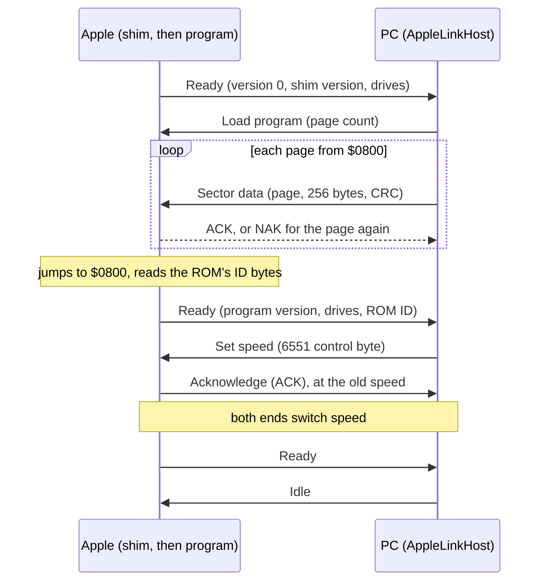
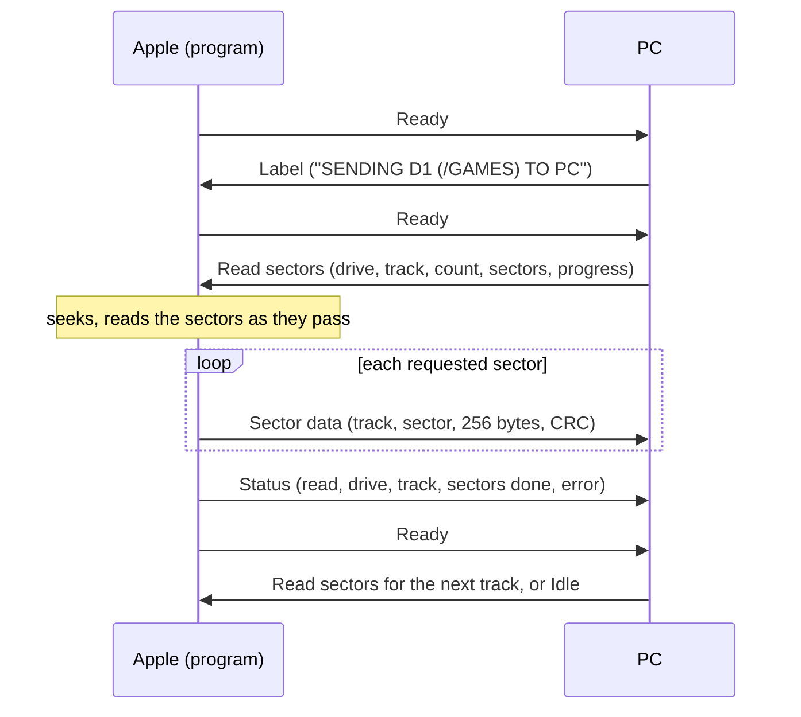
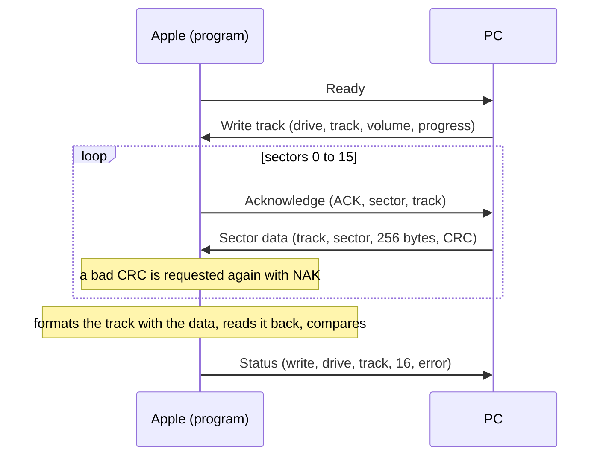
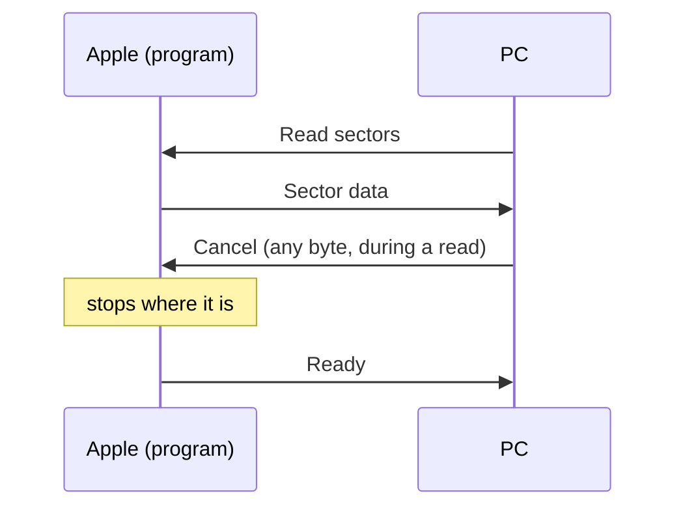
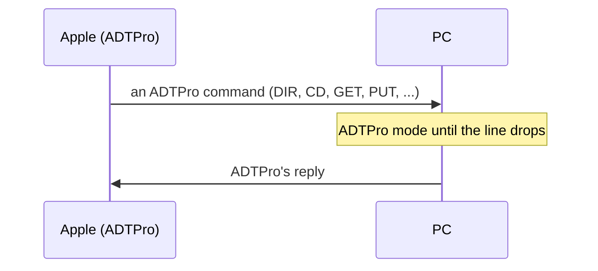

# Contract: CassoLink

Spec FR-083 to FR-098; research R15 to R23. This is the wire contract
between Casso and an Apple-side client, and between Casso Explorer and the
link's session. The values once marked *captured* were settled on 2026-10-15
from traffic between ADTPro 2.1.0's own host and client (R15); the
captures are in `UnitTest/Fixtures/AppleLink/`.

## Framing (ADTPro's, unchanged)

| Field | Bytes | Value |
|---|---|---|
| Start | 1 | `'A'` ($C1) |
| Payload length | 2 | LSB first |
| Command | 1 | below |
| Envelope check | 1 | EOR of the four bytes before it |
| Payload | n | per command |
| Payload check | 1 | EOR of the payload; absent when n is 0 |

ADTPro's data travels in Send Image Data ($D3). Its length field is the
length of the data after decoding (1,024 for two blocks), not counting the
start block or the CRC. The payload is a two-byte starting block (LSB, MSB)
and the data encoded page by page; a CRC-16/XMODEM (polynomial $1021,
initial value 0) of the decoded data, LSB first, takes the place of the
payload check. In the encoding, each byte is the difference from the
previous decoded byte, modulo 256, starting from 0 in each packet. A 0 is
followed by an offset within the current 256-byte page, and the previous
byte repeats up to that offset, 0 meaning the end of the page. Casso's
client uses Sector data (below) instead: unencoded, with the same CRC.

Replies differ by direction. A host receiving a packet (Put, Batch)
replies with one unframed byte, ACK $06 or NAK $15. A client receiving one
(Get) replies with Acknowledgement ($CB), whose payload is ACK or NAK and
the two-byte number of the next block to send.

A side that receives a damaged envelope or packet sends NAK. Casso resends
up to five times (FR-087). ADTPro's own peers, as captured:

- Its host resends a packet the client NAKs after 0.26 s, then after
  0.52 s, and stops after the third NAK. When the client next sends, the
  host ends the transfer with Home ($D8), with a check byte of $13 rather
  than the EOR, $19; its client accepts it.
- Its client waits about 2 s (2.03 to 2.09 million cycles) for a reply
  before sending again. When the host's ACKs are dropped it sends again with
  no limit, under the same starting block but with the data of later
  blocks, so a host ACKs a starting block it has already accepted and
  discards that packet's data.

When no byte arrives within 3 s, longer than the ADTPro client's 2 s so
that its resends arrive first, the link closes and the operation fails
(FR-087).

## ADTPro's client (served unchanged, FR-088)

Casso serves CD, Directory, Size, Get, Put, Batch, Multiple, Summary,
Home and Send File as ADTPro's host does, and serves virtual drives
(`'E'`, $C5) over 512-byte blocks. Image files are those in the folder open
in Casso Explorer's current tab, or the folder an open image is in; with
none, each request fails with ADTPro's "unable" status. Nibble ($CD) is
met with ADTPro's abort reply; raw tracks are the protected-disk follow-on's.

The virtual-drive packets are unframed. ADTPro's VSDRIVE driver reads with
Read3 ($03 for drive 1, $05 for drive 2), whose reply has the host's ProDOS
date and time ahead of the block, and writes with $02 or $04. Each header's
check is the EOR of the bytes before it in the header, except in the reply
to a write, which ends with the written block's check; and each block's
check is the EOR of its 512 bytes alone. The driver's first request at
startup can arrive twice before the host's first reply.

## Casso's client (extended)

Every command below is outside ADTPro's set, in the same framing. The
client sends first; the host's reply is the next operation.

| Command | Byte | From | Payload |
|---|---|---|---|
| Ready | $D2 `'R'` | client | program version (2), shim version (1), drive map (1: bit per slot 6 drive 1/2, //c internal and external); the program adds the ROM's identification bytes $FBB3, $FBC0, $FBBF and $FB1E, and 1 for a IIgs (5), from which the host has the model |
| Idle | $C9 `'I'` | host | none; client sends Ready again after 100 ms |
| Sector data | $CA `'J'` | either | track (1), sector (1), 256 bytes unencoded, CRC-16/XMODEM of the 256 bytes (2, LSB first) |
| Load program | $CF `'O'` | host | page count (1); then Sector data packets, one per page from $0800, with the page number in the track and sector fields, each followed by the shim's bare ACK or NAK byte; the shim jumps to $0800 after the last. Sent to a running program, it returns that program to the shim, whose Ready follows |
| Set speed | $D7 `'W'` | host | 6551 control byte (1); the client acknowledges ($CB, ACK, 0, 0) at the old speed, and both ends then switch |
| Read sectors | $D5 `'U'` | host | drive (1), track (1), count (1), sector list (count), progress (2); client replies with Sector data per sector |
| Write sectors | $D6 `'V'` | host | drive (1), track (1), count (1), sector list (count), progress (2); for each sector the client sends Acknowledge ($CB: ACK, sector, track) with the number of the sector to send, or NAK for another copy of a damaged one, and the host sends its Sector data; the client writes it and reads it back before the next Acknowledge |
| Format track | $C8 `'H'` | host | drive (1), track (1), volume (1), progress (2) |
| Write track | $DB `'[']` | host | drive (1), track (1), volume (1), progress (2); the client requests each of the 16 sectors in physical order as for Write sectors, then formats the track with their data in one revolution, reads it back and compares it; reported as a write |
| (progress) | | | the part of the user's whole operation a request covers, as its starting and ending percentage (0-100), for the program's status row |
| Status | $D4 `'T'` | client | operation (1: 1 read, 2 write, 3 format), drive (1), track (1), sectors done (1), error (1); ends every Read, Write and Format |
| Label | $CE `'N'` | host | up to 38 ASCII characters, the user's operation; the program prints it and sends Ready (R24) |
| Cancel | $D1 `'Q'` | host | none; client stops, replies Ready (FR-098). During a read, any byte from the host is taken as Cancel, as the 6551 has room for only the first while the drive is busy |

The host distinguishes clients by the first command it receives: Ready is
Casso's client; any command in ADTPro's set is ADTPro's client (R16).

Status error codes: $00 none, $10 write-protected, $20 no address field
for the sector, $30 the data field did not decode, $40 the sector read back
differently, $50 the host's data did not arrive whole, $60 no such drive.
A sector is the physical sector, the number in its address field.

The shim occupies $3D00 to $3FFF, with the 6551 control byte for its starting speed at $3D02, the speed's text at $3D06, and a Wi-Fi modem's dial command, ending in a zero byte, at $3D0C (R24); the program
runs from $0800 and uses $4000 to $92FF for buffers, with no DOS or ProDOS
in memory.

## Sequences

Each diagram has the Apple on the left and the PC on the right, with time
running down. The Apple always speaks first; every reply from the PC is the
answer to the Apple's last packet.

### Connecting, and loading the program

The shim's Ready has program version 0, so the PC sends the program a page
at a time; a page whose CRC fails is sent again after a NAK. The program's
own Ready has its version, and the PC replies with Idle.



### Idle, and a dropped Apple

While nothing is queued the Apple sends Ready about every 100 ms, and each
Idle clears its label row. Three seconds with no byte, or DSR dropping on
a serial cable wired to the Apple's DTR, is the Apple gone: a reset, a
power-off or a pulled cable. The PC closes the line and opens it again
every five seconds.

```mermaid
sequenceDiagram
    participant A as Apple (program)
    participant P as PC
    loop while nothing is queued
        A->>P: Ready
        P->>A: Idle
        Note over A: waits 100 ms, clears the label row
    end
    Note over A: reset, or turned off
    Note over P: 3 s with no byte, or DSR off
    Note over P: Disconnected; the line opens again after 5 s
```

### Reading a track

The label goes first, then one request per track. The Apple reads the
requested sectors as they pass under the head, then sends each in the
order requested, and ends with Status.



### Writing a whole track

Each sector is requested by an Acknowledge with its number, and encoded
as it arrives; the track is then written in one revolution and read back.



### Canceling



### ADTPro's client

ADTPro's client also speaks first, with one of its own commands rather than
Ready; the PC serves it in ADTPro's protocol until the line drops, and
then waits to see which client is there next.



## Bootstrap (R23)

At 9,600 baud, 250 ms after each line, into the //c's monitor through
`IN#2`: `CALL -151`, the shim as `3D00:` lines of 8 bytes, `3D00G`. The shim
then sends Ready at 9,600 baud and receives Load program. A shim on a boot
disk starts at the link's speed instead.

The shim's screen: a title, then `WAITING FOR THE PC ON PORT 2 AT <speed>`,
`LOADING PROGRAM <n>%` and `STARTING VERSION <n>`. The program adds a PC line,
`CONNECTED` or `NO REPLY FOR <n> S`, sending Ready again after each second
with no reply; an error line with the last Status error until an operation
succeeds; and the last Label.

## Session interface (Casso Explorer side)

`AppleLinkSession` owns an `IByteStream`, the protocol engine, a
`LinkedDisk` per drive and a queue of `LinkOperation`s. Casso Explorer
calls only:

| Call | Effect |
|---|---|
| `Start (settings)` | opens the stream (FR-097), waits for Ready, loads the program if versions differ |
| `ListDrives` | the drive map from Ready, with each volume's name once read |
| `Enumerate (drive, inner)` | a catalog over the drive's `LinkedDisk`, faulting sectors in (R20) |
| `ReadFile` / `WriteFile` / `Delete` / `Rename` / `MakeDirectory` | the volume's own operation over the `LinkedDisk`; writes send only changed sectors |
| `ReadDisk (drive, format, path)` | every track, then the image written atomically (FR-086) |
| `WriteDisk (drive, path)` | every track formatted, written and read back |
| `Cancel` | the running operation stops; queued ones remain |
| `Stop` | the stream is closed and the port released |

Progress and results are posted to the window; no call waits on the line.
