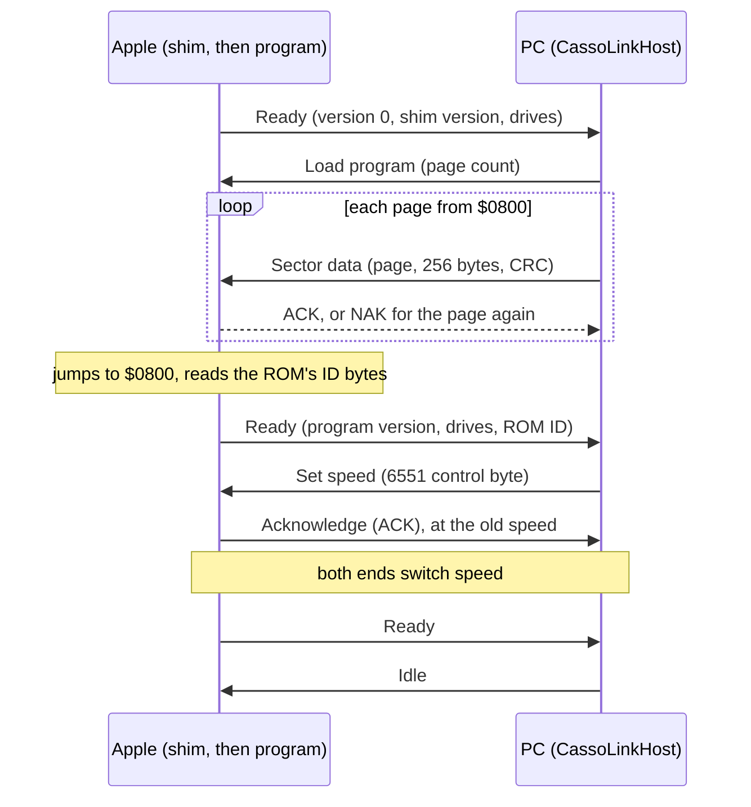
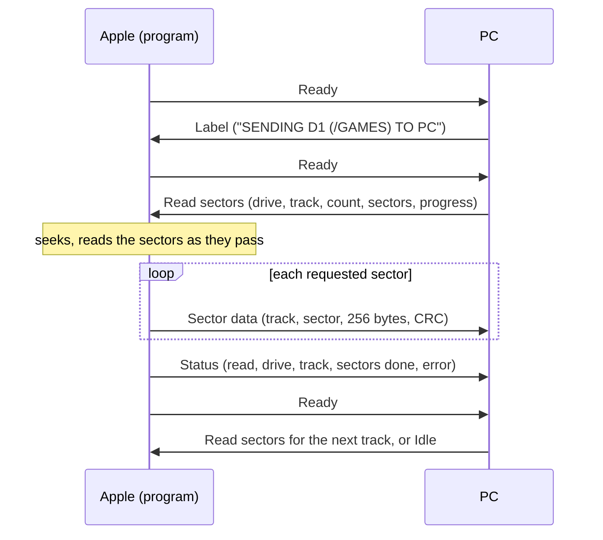
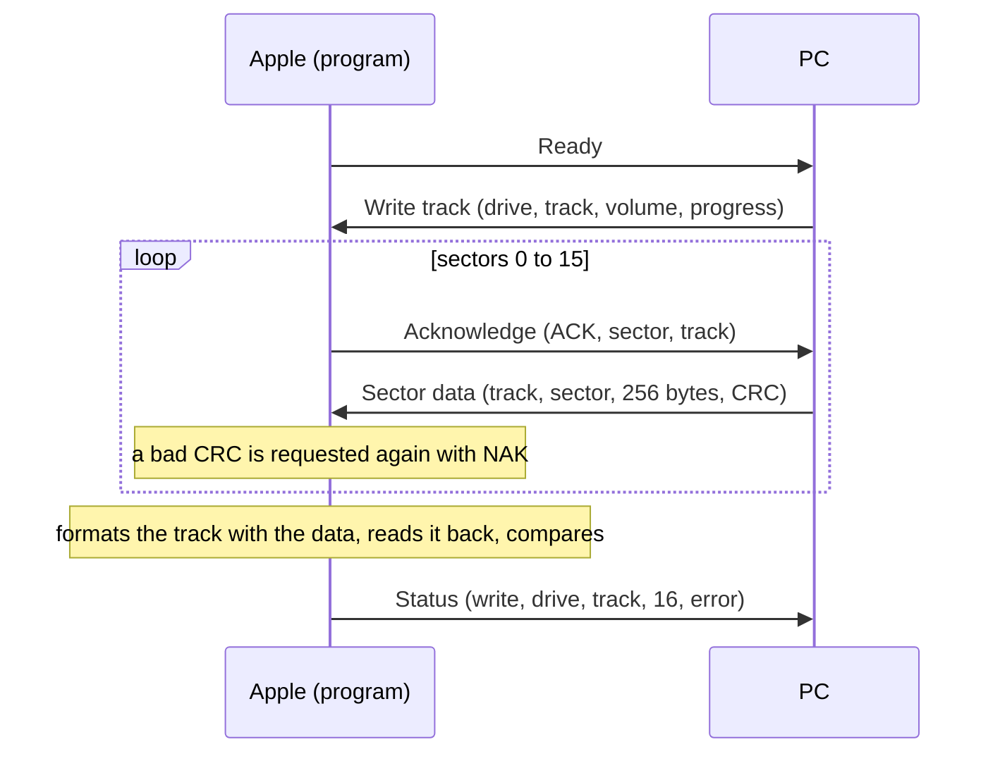
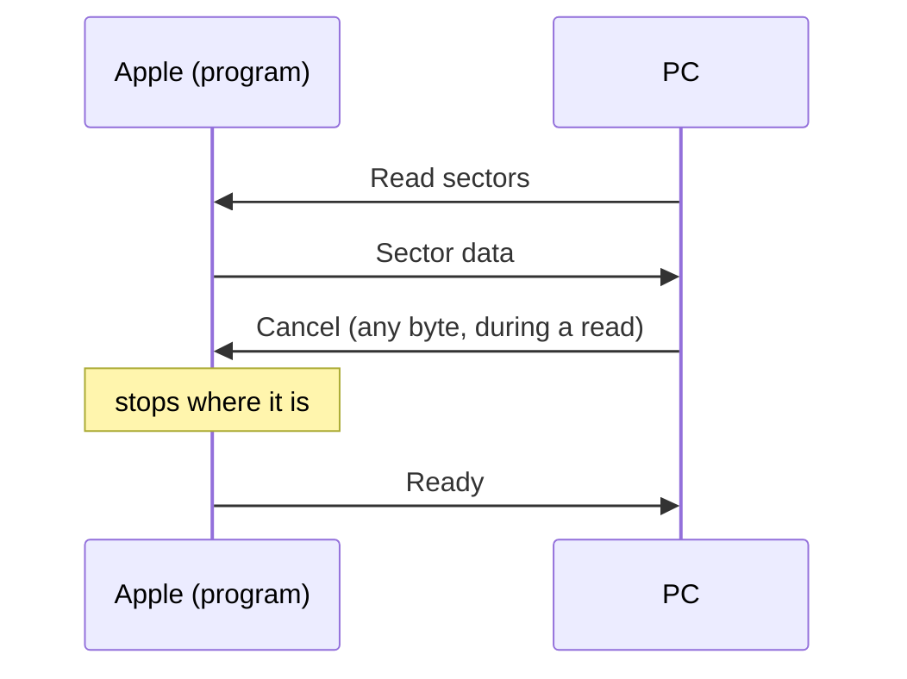
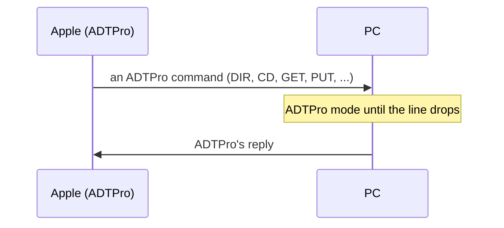

# Contract: CassoLink

Spec FR-083 to FR-098; research R15 to R23. This is the wire contract
between Casso and an Apple-side client, and between Casso Explorer and the
link's session. The values once marked *captured* were settled on 2026-10-15
from traffic between ADTPro 2.1.0's own host and client (R15); the
captures are in `UnitTest/Fixtures/CassoLink/`.

## Framing (ADTPro's, unchanged)

| Field | Bytes | Value |
|---|---|---|
| Start | 1 | `'A'` ($C1) |
| Payload length | 2 | LSB first |
| Command | 1 | below |
| Envelope check | 1 | EOR of the four bytes before it |
| Payload | n | per command |
| Payload check | 1 | EOR of the payload; absent when n is 0 |

ADTPro's data travels in Send Image Data ($D3). Its length field is the
length of the data after decoding (1,024 for two blocks), not counting the
start block or the CRC. The payload is a two-byte starting block (LSB, MSB)
and the data encoded page by page; a CRC-16/XMODEM (polynomial $1021,
initial value 0) of the decoded data, LSB first, takes the place of the
payload check. In the encoding, each byte is the difference from the
previous decoded byte, modulo 256, starting from 0 in each packet. A 0 is
followed by an offset within the current 256-byte page, and the previous
byte repeats up to that offset, 0 meaning the end of the page. Casso's
client uses Sector data (below) instead: unencoded, with the same CRC.

Replies differ by direction. A host receiving a packet (Put, Batch)
replies with one unframed byte, ACK $06 or NAK $15. A client receiving one
(Get) replies with Acknowledgement ($CB), whose payload is ACK or NAK and
the two-byte number of the next block to send.

A side that receives a damaged data packet sends NAK. A damaged command
envelope has no reply, as from ADTPro's host: the client sends the command
again once its wait for a reply runs out. Casso resends up to five times
(FR-087). ADTPro's own peers, as captured:

- Its host resends a packet the client NAKs after 0.26 s, then after
  0.52 s, and stops after the third NAK. When the client next sends, the
  host ends the transfer with Home ($D8), with a check byte of $13 rather
  than the EOR, $19; its client accepts it.
- Its client waits about 2 s (2.03 to 2.09 million cycles) for a reply
  before sending again. When the host's ACKs are dropped it sends again with
  no limit, under the same starting block but with the data of later
  blocks, so a host ACKs a starting block it has already accepted and
  discards that packet's data.

When no byte arrives within 3 s, longer than the ADTPro client's 2 s so
that its resends arrive first, the link closes and the operation fails
(FR-087).

## ADTPro's client (served unchanged, FR-088)

Casso serves CD, Directory, Size, Get, Put, Batch, Nibble ($CE), Multiple
nibble ($CD) and Summary as ADTPro's host does, and serves virtual drives
(`'E'`, $C5) over 512-byte blocks, on an ADTPro-compatible server
connection only (R28). Image files are those in the folder the connection
shares, and a path outside that folder's subtree, by `..`, a drive, a UNC
path or a junction, has ADTPro's error reply. Home has no reply, as from
ADTPro's host. Send File and ADTPro's older commands are not served.

- **Directory** ($C4): the payload is an optional filespec (`*` and `?`,
  without regard to case) ending in a 0, then the page number as its last
  byte. A page has a header of at most two 40-column lines,
  `DIRECTORY OF: ` and the path when the path has at most 66 characters,
  keeping the end of a longer one; a return ends a header shorter than 80
  characters and a second follows one of at most 40, so the names start on
  the screen's fourth row. 40 dashes follow, then up to 18 names, each
  ending in a return unless it fills its line; a name longer than 40 is cut
  to 38 characters and `..`. An empty folder lists `NO FILES`. The text
  ends in a 0, and the byte after it is 1 when another page follows.
- **File chooser token**: in place of a file name, Size and Get accept
  the client's token for a name picked from the last listing: $01, the page
  counted from 1, and the screen row, the first name being on row 3. It
  resolves to name 18 × (page − 1) + (row − 3) of that listing, after the
  filespec.
- **Received files**: Put adds `.dsk` to a 140 KB image unless it ends in `.dsk` or
  `.do`, and `.po` to any other unless it ends in `.po` or `.hdv`. Each image a
  Batch receives is the prefix and the next free 4-digit number from 0001,
  with `.dsk` for 140 KB and `.po` otherwise.
- **Nibble send**: the reply to the command is a status byte, then 35
  tracks, each a 13,312-byte capture sent as Image data packets, each
  packet ACKed, and then an ACK for the track, which the client waits for
  before reading the next. The Summary ($D9) follows the last track, as it
  follows every Put and Batch. The image is written as a `.nib` of 6,656
  bytes a track: one revolution from the track's first address field,
  padded with $FF, or the capture's first 6,656 bytes for a track with no
  address field.
- **No keepalive**: an idle ADTPro client sends nothing, and before each
  byte it waits for DSR, so any ADTPro-compatible cable connects the
  handshake line that Casso monitors to detect a machine dropping.

The virtual-drive packets are unframed. ADTPro's VSDRIVE driver reads with
Read3 ($03 for drive 1, $05 for drive 2), whose reply has the host's ProDOS
date and time ahead of the block, and writes with $02 or $04. Each header's
check is the EOR of the bytes before it in the header, except in the reply
to a write, which ends with the written block's check; and each block's
check is the EOR of its 512 bytes alone. The driver's first request at
startup can arrive twice before the host's first reply. A write changes
only its block of the image file, at the block's offset.

## Casso's client (extended)

Every command below is outside ADTPro's set, in the same framing. The
client sends first; the host's reply is the next operation.

| Command | Byte | From | Payload |
|---|---|---|---|
| Ready | $D2 `'R'` | client | program version (2), shim version (1), drive map (1: bit per slot 6 drive 1/2, //c internal and external); the program adds the ROM's identification bytes $FBB3, $FBC0, $FBBF and $FB1E, and 1 for a IIgs (5), from which the host has the model |
| Idle | $C9 `'I'` | host | none; client sends Ready again after 100 ms |
| Sector data | $CA `'J'` | either | track (1), sector (1), 256 bytes unencoded, CRC-16/XMODEM of the 256 bytes (2, LSB first) |
| Load program | $CF `'O'` | host | page count (1); then Sector data packets, one per page from $0800, with the page number in the track and sector fields, each followed by the shim's bare ACK or NAK byte. A page numbered at or past the page count gets a NAK and isn't stored. The shim jumps to $0800 after the last. Sent to a running program, it returns that program to the shim, whose Ready follows |
| Set speed | $D7 `'W'` | host | 6551 control byte (1); the client acknowledges ($CB, ACK, 0, 0) at the old speed, and both ends then switch. Rate 1, 50 baud on a 6551, indicates 230,400 baud, which only a IIgs's port has: any other interface sends a NAK, its speed doesn't change, and the host sends 115,200 instead |
| Read sectors | $D5 `'U'` | host | drive (1; bit 7 set for a check the PC reports itself, such as its read of a catalog when it connects, for which no error is drawn), track (1), count (1), sector list (count), progress (2); client replies with Sector data per sector |
| Write sectors | $D6 `'V'` | host | drive (1), track (1), count (1), sector list (count), progress (2); for each sector the client sends Acknowledge ($CB: ACK, sector, track) with the number of the sector to send, or NAK for another copy of a damaged one, and the host sends its Sector nibbles; the client writes it and reads it back before the next Acknowledge |
| Sector nibbles | $CC | host | track (1), sector (1), the sector's data field as 6-and-2 nibbles, encoded on the PC so the Apple writes them as they arrive (343), CRC-16/XMODEM of the nibbles (2, LSB first) |
| Format track | $C8 `'H'` | host | drive (1), track (1), volume (1), progress (2), gap (1): the self-sync bytes after each sector, 0 for 10 |
| Write track | $DB `'[']` | host | drive (1), track (1), volume (1), progress (2), gap (1); the client requests each of the 16 sectors in physical order as for Write sectors, and the host sends Sector data, or Sector blank for a sector whose bytes are all one value; the client then formats the track with their data in one revolution, reads it back and compares it; reported as a write |
| Sector blank | $E0 | either | track (1), sector (1), value (1): a sector whose 256 bytes are all the value, sent in place of Sector data; the client sends one for such a sector in reply to Read sectors, and the host for one in Write track |
| Read CRCs | $E4 | host | drive (1; bit 7 as for Read sectors), track (1), count (1), sector list (count), progress (2); the client reads the sectors as for Read sectors and replies with Sector CRCs, then Status |
| Sector CRCs | $E5 | client | per sector: CRC-16/XMODEM of its 256 bytes (2, LSB first) and 1 if it was read, 0 if not (1). A sector not read is not an error here |
| Time drive | $DE | host | drive (1), track (1), revolutions (1), progress (2); the client sends a bare $A5 each time sector 0's address field passes after the first, so the PC times a revolution, then Status. Status in place of a marker ends a track with no sector 0 |
| (progress) | | | the part of the user's whole operation a request covers, as its starting and ending percentage (0-100), for the drive's bar on the program's status screen. With 0 and 0 the bar is not redrawn; only a whole-disk transfer sends other values, as the bar has a cell for each track |
| Status | $D4 `'T'` | client | operation (1: 1 read, 2 write, 3 format), drive (1), track (1), sectors done (1), error (1); ends every Read, Write and Format |
| Label | $DC `'\'` | host | up to 38 ASCII characters, the user's operation; the program prints it and sends Ready (R24) |
| Log | $DD | host | hour (1), minute (1), up to 34 ASCII characters; the program draws it at the top of the history, moving the rest down, and sends Ready |
| Set columns | $E3 | host | 1 for 80 columns where the machine has them, 0 for 40 (1); the program draws its screen again and sends Ready |
| Exit | $DF | host | none; CassoLink ends, the machine's state is put back, and control returns to BASIC |
| Session screen | $E1 | host | active (1), tone (1: 0 none, 1 done, 2 duplicate, 3 bad sectors, 4 likely copy-protected), then the screen's rows as ASCII text, up to 80 characters each and each ending in a zero, with bit 7 set for inverse video; the PC composes the rows. The program draws them, sounds the tone and sends Ready. Not active clears the rows and returns to the CassoLink screen, as does the PC's silence |
| Wait for key | $E2 | host | the prompt's lines, each ending in a zero; the program turns the motor off, draws them and polls the keyboard. It replies Key on Space, Q, 1 or 2, and Key with code 0 each second until then. Esc is ignored. Any byte from the host is taken as Cancel |
| Key | $E2 | client | code (1): $A0 Space, $D1 Q, $C6 F, $B1 1, $B2 2, $D6 V, 0 no key. Besides the replies to Wait for key, the program sends $C6 ahead of Ready for F on the CassoLink screen, $D1 for Q during a session, and $D6 for V, which turns a Full Send's verification on or off |
| Cancel | $D1 `'Q'` | host | none; client stops, replies Ready (FR-098). During a read, any byte from the host is taken as Cancel, as the 6551 has room for only the first while the drive is busy |

The host distinguishes clients by the first command it receives: Ready is
Casso's client; any command in ADTPro's set is ADTPro's client (R16).

Status error codes: $00 none, $10 write-protected, $20 no address field
for the sector, $30 the data field did not decode, $40 the sector read back
differently, $50 the host's data did not arrive whole, $60 no such drive.
A sector is the physical sector, the number in its address field.

The shim occupies $3A00 to $3FFF, with its startup part after it to at most $43FF and its copy of the machine's zero page at $3900, the 6551 control byte for its starting speed at $3A02, the speed's text at $3A06, a Wi-Fi modem's dial command, ending in a zero byte, at $3A0C (R24), and the 6551's slot at $3A38: 2 for the //c's port 2, or a Super Serial Card's slot. The byte at $3A39 is 0 for a 6551, $80 for a card run through its Pascal 1.1 firmware and $C0 for a IIgs's port, driven through its 8530; the jumps at $3A3A, $3A3D and $3A40 are the status, read and write calls for the last two; $3A43 is a IIgs's speed register as the program found it, plus 1; and the jump at $3A44 sets a IIgs's port to the speed of the 6551 control byte in A, which is stored as the starting speed (R47). Before Load program, the program sets bit 7 of the dial command's first byte, and the shim does not dial a command marked this way. The W5100 shim has the same address and header. The program
runs from $0800 and uses $4000 to $92FF for buffers, with no DOS or ProDOS
in memory.

## Sequences

Each diagram has the Apple on the left and the PC on the right, with time
running down. The Apple always speaks first; every reply from the PC is the
answer to the Apple's last packet.

### Connecting, and loading the program

The shim's Ready has program version 0, so the PC sends the program a page
at a time; a page whose CRC fails is sent again after a NAK. The program's
own Ready has its version, and the PC replies with Idle.



### Idle, and a dropped Apple

While nothing is queued the Apple sends Ready about every 100 ms, and each
Idle clears its label row. Three seconds with no byte, or DSR dropping on
a serial cable wired to the Apple's DTR, is the Apple gone: a reset, a
power-off or a pulled cable. The PC closes the line and opens it again
every five seconds.

```mermaid
sequenceDiagram
    participant A as Apple (program)
    participant P as PC
    loop while nothing is queued
        A->>P: Ready
        P->>A: Idle
        Note over A: waits 100 ms, clears the label row
    end
    Note over A: reset, or turned off
    Note over P: 3 s with no byte, or DSR off
    Note over P: Disconnected; the line opens again after 5 s
```

### Reading a track

The label goes first, then one request per track. The Apple reads the
requested sectors as they pass under the head, then sends each in the
order requested, and ends with Status.



### Writing a whole track

Each sector is requested by an Acknowledge with its number, and encoded
as it arrives; the track is then written in one revolution and read back.



### Canceling



### ADTPro's client

ADTPro's client also speaks first, with one of its own commands rather than
Ready; the PC serves it in ADTPro's protocol until the line drops, and
then waits to see which client is there next.



## Bootstrap (R23)

At 9,600 baud, 250 ms after each line, into the //c's monitor through
`IN#2`: `CALL -151`, the shim as `3D00:` lines of 8 bytes, `3D00G`. The shim
then sends Ready at 9,600 baud and receives Load program. A shim on a boot
disk starts at the link's speed instead. On a Super Serial Card the user
types `IN#` and the card's slot, and Ctrl-A `14B` then Return; the card's firmware executes the command at the
Return.

On a ][+ or //e, the cassette bootstrap is the shim as one monitor tape
record, sent as audio into the cassette input after `CALL -151` and
`3D00.3FFFR 3D00G` are typed: a 770 Hz leader of 6 seconds, the sync
half-cycles of 200 and 250 microseconds, the bytes most significant bit
first, a 0 as one 2 kHz cycle and a 1 as one 1 kHz cycle, and the XOR
checksum seeded with $FF. The shim starts at the link's speed.

The shim's slot (R29): the header's when the boot disk's stage started it;
else the input hook's high byte at $39 when it is $C1 to $C7, as `IN#n`
left it; else the first slot with the Super Serial Card's identification
bytes. The 6551 is at $C088 plus 16 times the slot.

The shim's screen: a title, then `DIALING <target>` while a Wi-Fi modem
dials, the dial command after `ATDT` and its spaces in capitals; `WAITING FOR
THE PC ON:` with the interface below a blank row, as the universal disk lists
it: `SERIAL PORT <n>, <speed>` on a //c, `SSC, SLOT <n>, <speed>` on a card,
and `WI-FI MODEM, PORT <n>, <speed>` or `WI-FI MODEM, SLOT <n>, <speed>`
through a modem; `LOADING PROGRAM <n>%` and `STARTING VERSION <n>`. The
program's status screen has the connection; for a modem, `DIALED:` and the
target on the row below it, and for an Uthernet II, `ADDRESS:` and the card's
address and port. The program adds a PC line,
`CONNECTED` or `NO REPLY FOR <n> S`, sending Ready again after each second
with no reply; an error line with the last Status error until an operation
succeeds; and the last Label.

## The Apple's memory

The serial and W5100 builds, as each is loaded:

| Range | Contents |
|---|---|
| $0400–$07FF | the text page, and on a //e, //c or IIgs the auxiliary text page for 80 columns |
| $0800–about $35FF | the program; it must end below $3900 |
| $3900–$39FF | the shim's copy of the machine's zero page |
| $39A0–$39FF, $3950–$39FF | the slot finder or the serial loader, typed in ahead of the shim and run once before the zero page is copied over them |
| $3A00–$3FFF | the shim's resident code, header first |
| after it, to at most $43FF | the 6551 shim's startup part: run once, then built over by the program's tables |
| $4000–$4FFF | the program's tables and small buffers |
| $5000–$8FFF | the disk buffers, and a module with its buffers, which a disk operation clears |
| $9000–$957F | the encoding tables and Krunch's copy of the history |
| $9600–$BFFF | not used, so DOS is intact at exit |

The shim's first start runs its startup part, which saves the zero page and
reset vector, finds and sets up the interface, and dials a modem, then
marks the header's byte at $3A47. A start from Load program sets the
interface to the starting speed again and goes on to Ready.

## The universal boot disk

Casso Explorer's boot disk works on every interface, as ADTPro's does. It
loads a first stage at $2000, with the 6551 shim and its startup part at
$2C00 and the W5100 shim at $4400, both built for $3A00, and the stage's copy
of the zero page at $3600. The host writes both shims'
headers as for their own disks.

The stage finds:

- on a //c, ports 1 and 2;
- a Super Serial Card in any slot, by $Cn05 = $38, $Cn07 = $18, $Cn0B = $01,
  a serial card's or a modem's class in $Cn0C, and a 6551;
- on a IIgs, its modem and printer ports, by the same bytes, $Cn0C = $31 and
  no 6551, each set to the shim's speed through its 8530 and listed as
  SERIAL PORT 1 or SERIAL PORT 2;
- up to two cards with the same bytes and no 6551, waited on through their
  Pascal firmware;
- an Uthernet II in any other slot but a Disk II's, by its mode register
  at $C084 plus 16 times the slot reading with bits 6, 5 and 2 clear, and
  then the W5100 taking two address pointer values and returning them.

The header's MAC address has the sum of RNDL and RNDH ($4E, $4F) and a
16-bit sum of $4000-$BFFF added into its last three bytes before the
W5100 is given it (R31).

Each 6551 is set to the 6551 shim's speed with DTR on. The W5100 is reset,
given the header's MAC address, 8 KB of receive memory and 4 KB of transmit
memory to socket 0 and 4 KB of transmit memory to socket 1, and an address
by DHCP: DISCOVER, OFFER, REQUEST and ACK from port 68 to port 67 broadcast,
the transaction ID the MAC address's last four bytes, three attempts of about
three seconds each. With no ACK the header's address is used. Socket 0 then
listens on the header's port, and socket 1 broadcasts an announcement to UDP
port 6510 from port 6511 about every two seconds:

| Bytes | Field |
|---|---|
| 9 | `CASSOLINK` in ASCII |
| 1 | version, 1 |
| 4 | the W5100's address |
| 2 | its TCP port, high byte first |
| 6 | its MAC address |

The screen: the title, `WAITING FOR THE PC ON:`, then a row for each
interface: `SERIAL PORT <n>, <speed>` on a //c, `SSC, SLOT <n>, <speed>` for
a card, and `UTHERNET II, SLOT <n>, <address>:<port>` for the Uthernet II.

The stage waits on all of them. A $C1 byte, an envelope's start, on a 6551,
or a connection to the W5100 chooses that interface: the stage copies the
machine's zero page and reset vector into the chosen shim, which it saved
before using any, sets the shim's zpsaved byte and slot, copies the shim to
its address and starts it. Started this way, a shim starts as one from its
own disk does, except that it saves nothing. A 6551 shim with a dial
command is started at once on the last 6551 found, a //c's port 2 or the
card in the highest slot, since no connection from the PC is possible until
the modem dials it.

Casso Explorer listens on UDP port 6510 on every interface, with the port
bound for reuse, and lists the Apple of each announcement, by its MAC
address, as an Uthernet II link at the announcement's address. An
announcement from this PC is Casso's emulated card, whose listening socket
is on 127.0.0.1, and is listed at 127.0.0.1.

## Session interface (Casso Explorer side)

`CassoLinkSession` owns an `IByteStream`, the protocol engine, a
`LinkedDisk` per drive and a queue of `LinkOperation`s. Casso Explorer
calls only:

| Call | Effect |
|---|---|
| `Start (settings)` | opens the stream (FR-097), waits for Ready, loads the program if versions differ |
| `ListDrives` | the drive map from Ready, with each volume's name once read |
| `Enumerate (drive, inner)` | a catalog over the drive's `LinkedDisk`, faulting sectors in (R20) |
| `ReadFile` / `WriteFile` / `Delete` / `Rename` / `MakeDirectory` | the volume's own operation over the `LinkedDisk`; writes send only changed sectors |
| `ReadDisk (drive, format, path)` | every track, then the image written atomically (FR-086) |
| `WriteDisk (drive, path)` | every track formatted, written and read back |
| `Cancel` | the running operation stops; queued ones remain |
| `Stop` | the stream is closed and the port released |

Progress and results are posted to the window; no call waits on the line.

## Modules (Stories 23 to 29, R40)

A module is a block of 6502 code assembled from `CassoLink/Apple/Modules/`,
loaded at $5000 to $8FFF after Ready (R40's revision). Its header: the module's id (1), version
(1), entry count (1), then a two-byte address per entry. The request codes
below are reserved here; each is allocated from the free codes in the
request table when its module is built, and this table is updated then.

| Request | From | Contents |
|---|---|---|
| Load module | host | id (1), version (1), address (2), length (2), the bytes in packets as the program is loaded, CRC-16/XMODEM (2); the client replies Ready with the module's id |
| List block devices ($EE) | host | none; the client replies with Block devices ($EF): a count, then per unit: slot (1), unit (1), SmartPort (1), blocks (3), kind (1, $FF for a ProDOS drive), volume name (16, ProDOS's, zeros for none) |
| Read blocks ($F0) | host | slot (1), unit (1), SmartPort (1), first block (3), count (1), verify (1), progress (2); the client replies with Block data ($F1) for each block: its number (3), 512 bytes and their CRC, then Status, whose count is the blocks done and whose error is the firmware's or ERRVERIFY |
| Write blocks ($F2) | host | as Read blocks; the client requests each block with an Acknowledge of its index, the host replies with its Block data, a NAK requests it again; the client writes each, reads it back when verify is on, and replies Status, whose count is the blocks done |
| Read quarter track | host | drive (1), position (1, 0 to 140), revolutions (1), reads (1); the client replies with the first read's bytes and timings, then per later read the ranges that differ, then Status. An empty position is one byte, $00 |
| Write nibble track ($F3) | host | drive (1), track (1), the stream's length (2); the client requests the stream with an Acknowledge, the host replies with Nibble data ($F4): the stream, each byte with its top bit set a nibble and each 0 a self-sync byte, and its CRC (2), a NAK requests it again; the client writes it in one pass and replies Status |
| Read 13-sector track ($F6) | host | drive (1), track (1), the sectors to read (2, a bit each, sector 0 in bit 0); the client reads each requested sector's address field, D5 AA B5 or RDOS's D4 AA B7, and its data field, for about six revolutions at most, then replies with a 13-sector data packet ($F7) for each sector found, in physical order: the sector (1), its data field's 410 nibbles and checksum nibble as the drive read them (411) and their CRC (2); or, for an address field with no data field after it, the sector with bit 7 set (1) alone. Then Status, whose count is the packets. The host decodes the 5-and-3 and requests the sectors not read again |
| Virtual block ($F5) | client | drive (1), operation (1: 0 status, 1 read, 2 write), block (2), and for a write the block and its CRC (2); the host replies with Virtual block: ProDOS's error (1), then for a status the drive's blocks (2) and for a read the block and its CRC (2). A request of the wrong length, or a write that fails its CRC, has no reply |
| Audio track | either | over cassette audio: track (1), the track's 16 sectors, CRC (2), in ADTPro's published audio encoding |

Modules and the requests they serve:

| Module | Requests | Machines |
|---|---|---|
| Block | List block devices, Read blocks, Write blocks | every Apple II with a ProDOS block device |
| Capture | Read quarter track | every Apple II with a Disk II |
| 13-sector | Read 13-sector track, Write nibble track | every Apple II with a Disk II |
| Cassette | Audio track, and the program's transport over cassette | ][+, //e |
| SCC | the program's transport | IIgs |
| Pascal firmware | the program's transport | any slot with a Pascal 1.1 serial card |
| CS8900A, LAN91C96 | the program's transport, with ARP, IPv4, UDP and TCP | the original Uthernet, the LANceGS |
| Virtual drive | Virtual block, from `CASSOLINK.SYSTEM`'s driver | ProDOS 8 with BASIC.SYSTEM |

The SOS interpreter (Story 29) is the program assembled for SOS, and the
Block module's requests are served through SOS's block calls.

## Resume (R42)

`NAME.partial.json` is written beside `NAME.partial` after every 64 blocks
verified, with the fields in data-model.md's ResumeRecord. A transfer of a
device whose slot, unit, block count, volume name and directory hash match
offers to continue at `lastVerifiedBlock + 1`.
